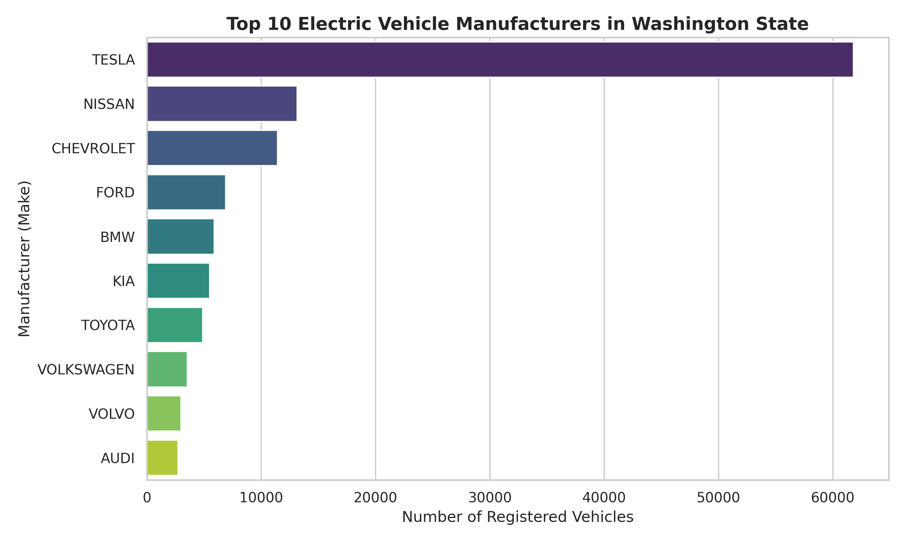
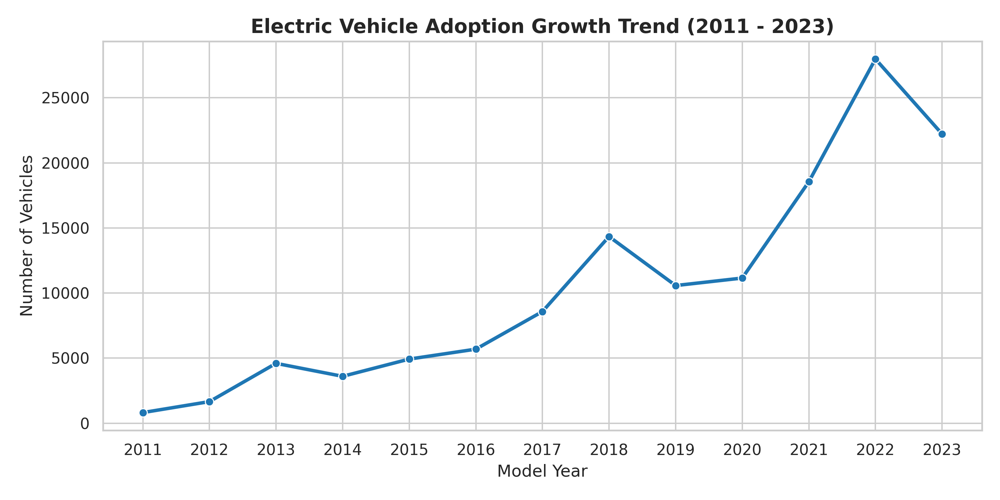
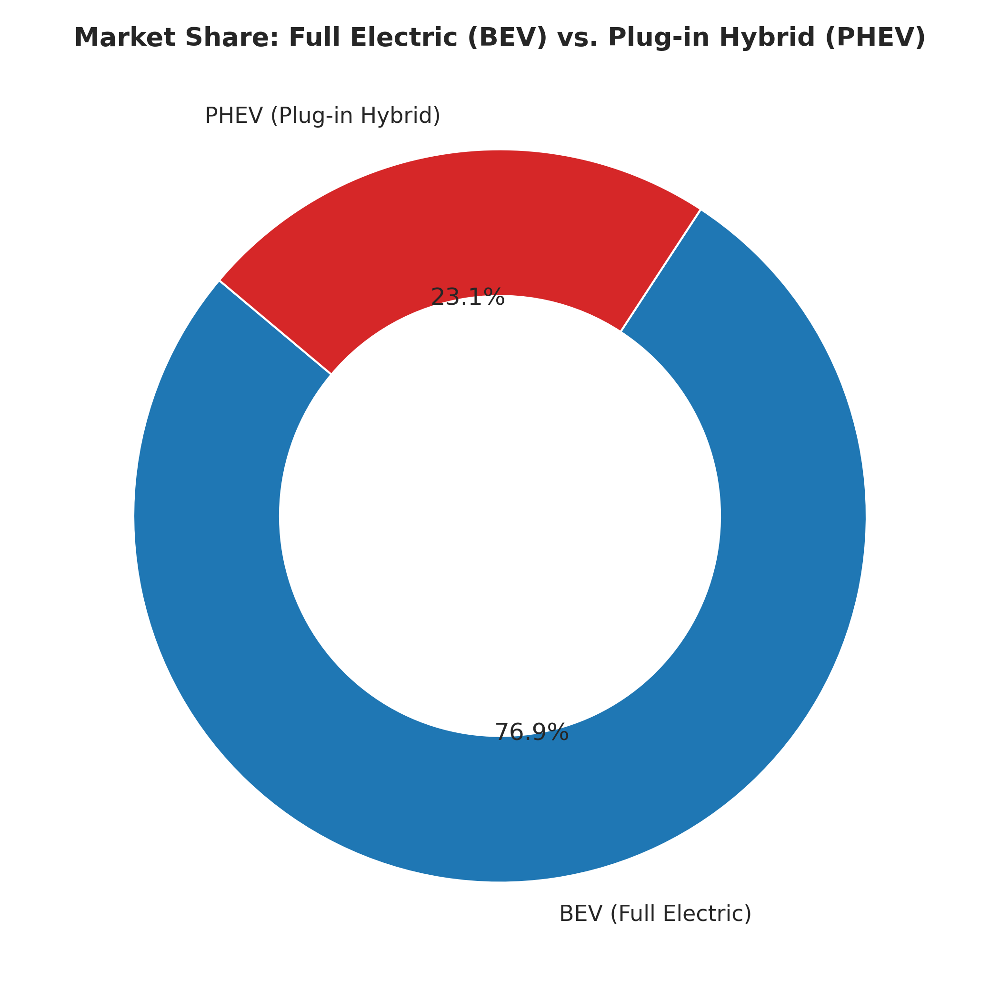
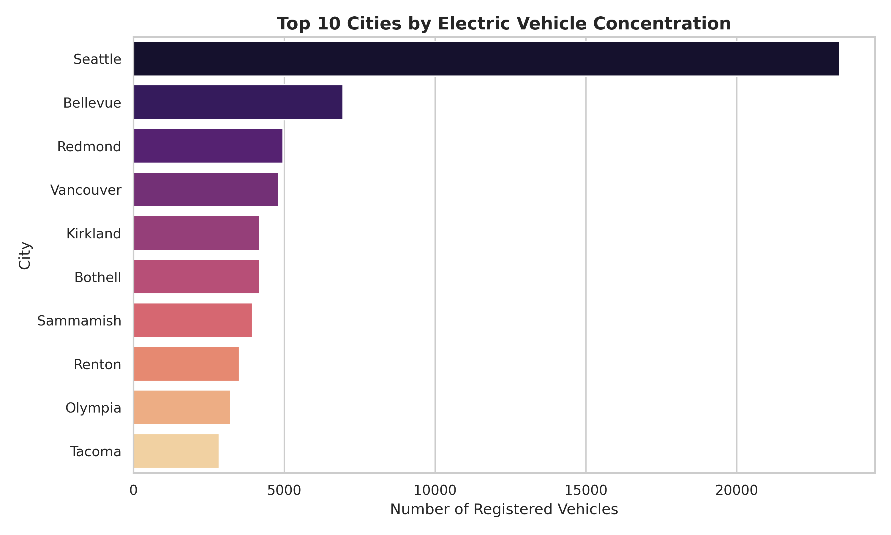

# تحليل بيانات سوق السيارات الكهربائية في ولاية واشنطن (EV Market Data Analysis)
# Electric Vehicle (EV) Market Data Analysis — Washington State

🔗 [**لوحة التحكم التفاعلية / Live Interactive Dashboard**]https://docs.google.com/spreadsheets/d/1Pq_ER9iavfJ2PEkpFsPSQ6vFHiuiybln8XwA9X3ZZZI/edit?usp=sharing)

---

##  ملخص المشروع 

### فكرة المشروع
قمت في هذا المشروع بتنظيف وتحليل بيانات تسجيل السيارات الكهربائية في ولاية واشنطن الأمريكية (أكثر من 135 ألف سجل من Kaggle). يهدف التحليل إلى قياس نمو تبنّي السيارات الكهربائية عبر السنوات، تحديد الحصص السوقية للشركات المصنعة، دراسة التركز الجغرافي للطلب، وتقييم فئات المدى الكهربائي، مع بناء لوحة تحكم تفاعلية (Dashboard) لتصفية المؤشرات حسب الشركة المصنعة.

### خطوات العمل وهندسة الميزات (Python / Pandas)
* **تنظيف البيانات (`clean_ev_market.py`):** حذف الأعمدة غير التحليلية (مثل أرقام الهوية التسلسلية)، إزالة أقل من 0.2% من السجلات الناقصة، وتبسيط مسميات السيارات الكهربائية بالكامل (`BEV`) والهجينة (`PHEV`).
* **هندسة الميزات والتحليل (`analyze_ev_market.py`):** تقسيم السيارات إلى شرائح حسب المدى الكهربائي بالميل (`Short`, `Medium`, `Long Range`)، وتحليل التركز الجغرافي لأكثر 10 مدن طلباً.
* **تجميع بيانات الداشبورد (`prepare_dashboard_data.py`):** ضغط 134,780 سجلاً في ملخص خفيف لربطه بلوحة تحكم تفاعلية مزودة بمؤشرات أداء (KPIs) ومقسّم للشركات.

### أبرز النتائج من تحليل السوق الأمريكي
1. **هيمنة شركة Tesla:** تستحوذ تسلا وحدها على **45.85%** من إجمالي السيارات المسجلة، تليها بفارق كبير شركات Nissan و Chevrolet.
2. **نمو السوق المتسارع:** شهدت التسجيلات قفزة كبيرة بدءاً من عام 2018 واستمرت في الارتفاع القياسي حتى عام 2023.
3. **تفضيل السيارات الكهربائية بالكامل:** يهيمن نوع `BEV` على السوق مقارنة بالسيارات الهجينة القابلة للشحن `PHEV`.
4. **التركز الحضري:** يتركز الطلب بشكل واضح في المدن الكبرى (مثل Seattle و Bellevue)، مما يوضح العلاقة المباشرة بين الكثافة الحضرية وتوفر البنية التحتية للشحن.

### 💡 ملاحظة منهجية واستفادة للأسواق الناشئة
بينما يقتصر هذا التحليل إحصائياً على بيانات ولاية واشنطن الأمريكية، فإن نتائجه تمثل **دراسة مرجعية (Benchmark)** مفيدة لصناع القرار والمستثمرين في الأسواق الناشئة (مثل **تونس وشمال أفريقيا**). فهي توضح أن التوسع الناجح في التنقل الكهربائي يعتمد على ثلاثة محاور: التركيز المبكر على البنية التحتية للشحن السريع في الأقطاب الحضرية الكبرى أولاً، الاستفادة من الحوافز الجبائية لتسريع التبنّي، والاعتماد على سيارات ذات مدى متوسط وطويل لتغطية التنقل بين المدن (مع مراعاة الفوارق الاقتصادية والقدرة الشرائية لكل سوق).

---

## 📊 الرسومات البيانية / Data Visualizations

### 1. أكبر 10 شركات مصنعة للسيارات الكهربائية / Top 10 EV Manufacturers


### 2. نمو تسجيل السيارات الكهربائية (2011 - 2023) / EV Adoption Growth Trend


### 3. مقارنة الكهربائية بالكامل مقابل الهجينة / Full Electric (BEV) vs. Plug-in Hybrid (PHEV)


### 4. أكثر 10 مدن تركزاً للسيارات الكهربائية / Top 10 Cities by EV Concentration


---

##  Project Summary

### Overview
This project analyzes the Electric Vehicle (EV) Population dataset from Washington State, USA (135,000+ records from Kaggle). The goal is to evaluate adoption growth trends, quantify manufacturer market shares, identify geographic demand hubs, and segment vehicles by battery range, supported by an interactive Google Sheets dashboard.

### Data Pipeline & Feature Engineering (Python / Pandas)
* **Data Cleaning (`clean_ev_market.py`):** Dropped non-analytical identifiers, removed <0.2% incomplete records, and standardized `BEV` vs. `PHEV` labels.
* **Feature Engineering & Analysis (`analyze_ev_market.py`):** Segmented vehicles into range tiers (`Short`, `Medium`, `Long Range` in miles) and analyzed urban concentration across the top 10 cities.
* **Dashboard Pre-Aggregation (`prepare_dashboard_data.py`):** Summarized 134,780 records into an optimized table powering live KPI cards and brand slicers.

### Key Findings (Washington State Market)
1. **Tesla Market Dominance:** Tesla accounts for **45.85%** of all registered EVs in the dataset, far ahead of competitors like Nissan and Chevrolet.
2. **Rapid Adoption Curve:** EV registrations surged starting in 2018 and maintained strong upward momentum through 2023.
3. **BEV Preference:** Full Battery Electric Vehicles (`BEV`) substantially outnumber Plug-in Hybrid Electric Vehicles (`PHEV`).
4. **Urban Demand Hubs:** Registrations cluster heavily in major urban centers such as Seattle and Bellevue, reflecting charging infrastructure availability.

### 💡 Methodological Note & Benchmark Value for Emerging Markets
While all statistical findings strictly reflect the U.S. (Washington State) market, this analysis serves as a useful **technical benchmark** for policymakers and investors in emerging EV markets (such as **Tunisia and North Africa**). It highlights that early EV adoption relies on urban-first fast-charging deployment, targeted fiscal incentives, and mid-to-long-range battery capabilities—while recognizing that local purchasing power and infrastructure readiness must be evaluated independently.

---

## 📁 هيكلية المشروع / Repository Structure
```text
├── data_raw/          # البيانات الخام من كاجل / Raw Kaggle CSV file
├── data_processed/    # البيانات النظيفة وملخص الداشبورد / Cleaned & aggregated CSVs
└── notebooks/         # أكواد بايثون والرسومات البيانية / Python scripts & 4 high-DPI charts
```

